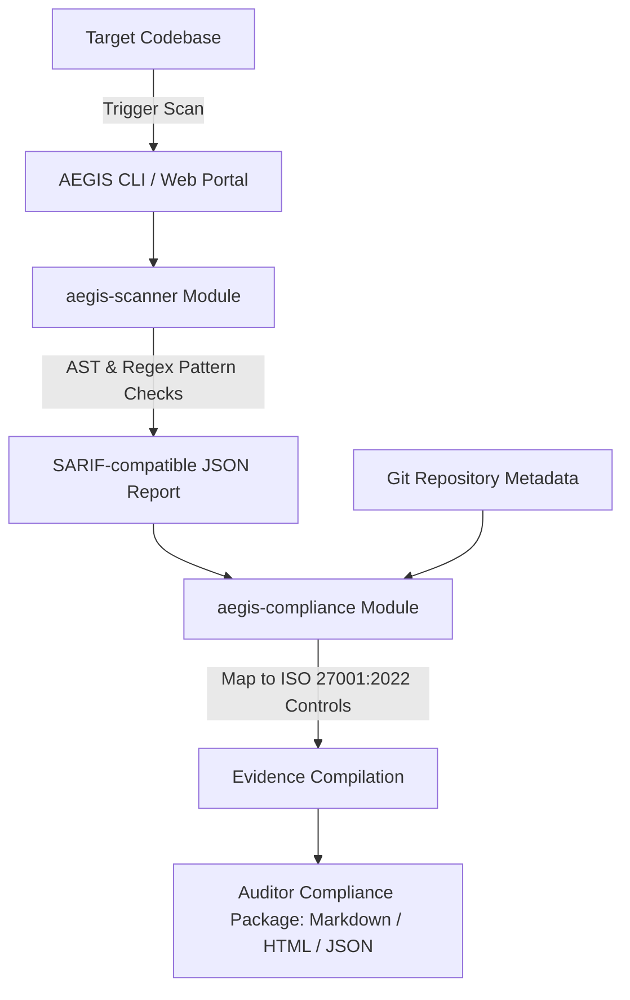

# 🛡️ AEGIS AI (Open-Core Engine)
> **Automated Security Code Scanner & ISO/IEC 27001 Compliance Evidence Generator**

[](https://nodejs.org/)
[](https://opensource.org/licenses/MIT)
[]()
[]()

AEGIS AI Core is a high-fidelity, open-source reference implementation of a security audit suite designed to support automated compliance pipelines. It demonstrates the engine mechanics for two primary modules:
1.  **Vulnerability & Secret Code Scanning (SAST)**: Automated checking of codebases for credential leaks, critical secrets, and common security design bugs.
2.  **ISO 27001 Evidence Generation**: Automatic compilation of scan results, repository metadata, and commit integrity signatures into auditor-ready reports mapped directly to ISO/IEC 27001:2022 security controls.

---

## 📸 Dashboard Preview

Here is the premium interactive local web portal designed to run scans, visualize findings, and export auditor compliance reports:


---

## ⚙️ Core Architecture



---

## 🛠️ Modules Overview

### 1. Code Security Scanner (`aegis-scanner`)
Runs local static analysis checks to catch vulnerabilities and secrets leaks before production:
*   **Secrets Detection**: Regex-based entropy checking for AWS Access Key IDs, Database URI strings, Slack Webhook URLs, and generic API/Bearer tokens.
*   **Vulnerability Checks (SAST)**: Scans JavaScript, TypeScript, Python, and HTML files for SQL injection vulnerabilities, unsafe `eval()` executions, client-side XSS vulnerabilities, and unsafe OS system commands.

### 2. ISO 27001 Evidence Compiler (`aegis-compliance`)
Translates developer metrics into structured auditor materials, mapping scan summaries to:
*   **Control A.8.28 (Secure Coding)**: Logs analysis of static scan profiles, files inspected, and rule configuration checks.
*   **Control A.8.29 (Security Testing in Dev)**: Outputs security vulnerability logs, severity categories, and remediation checklists.
*   **Control A.8.32 (System Acceptance)**: Aggregates git commit integrity signatures and sign-off timestamps.

---

## 🚀 Getting Started

### Prerequisites
*   Node.js (v18.0.0 or higher)
*   npm (v9.0.0 or higher)

### Setup & Installation
Clone the repository and install the dependencies:
```bash
git clone https://github.com/nickmountlion/aegis.git
cd aegis
npm install
```

### Execution Commands

#### 🔍 Run a Security Scan
Scan any local directory or codebase path:
```bash
node aegis-cli/bin/aegis.js scan [path_to_codebase]
```

#### 📄 Generate ISO 27001 Compliance Package
Scan and output structured Markdown and HTML auditor files to a local `./compliance-evidence/` folder:
```bash
node aegis-cli/bin/aegis.js evidence [path_to_codebase]
```

#### 💻 Start the Interactive Web Dashboard
Spawns the local HTTP server serving the visual UI panel:
```bash
node aegis-cli/bin/aegis.js dashboard
```
Open **[http://localhost:3000/](http://localhost:3000/)** in your browser. From here, you can input scan folders, trigger real-time compliance audits, and download compiled HTML/Markdown evidence sheets.

---

## 🧪 Self-Test Verification
The repository contains a pre-configured `mock-project` with test vulnerability patterns to verify the scanner. You can run the self-test suite:
```bash
node test-run.js
```

---

## 🔒 Confidentiality & Disclaimer
*This repository represents a neutral reference implementation of the core security scanning and evidence aggregation mechanics. It contains **no proprietary client data, corporate APIs, internal infrastructure references, or EPAM confidential data**. It serves as an open-core portfolio project to verify technical capability and design patterns.*

---

## 📄 License
This project is licensed under the MIT License - see the [LICENSE](LICENSE) file for details.
