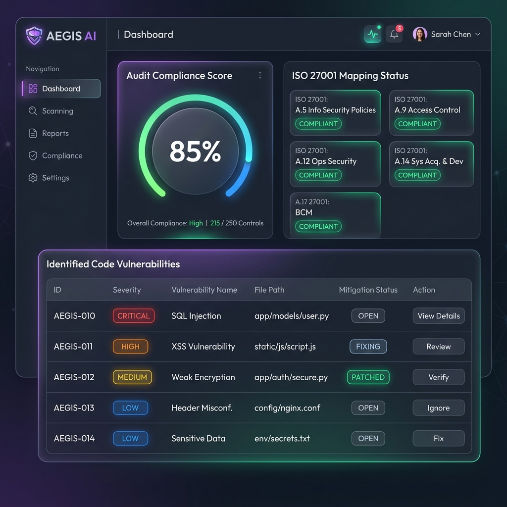
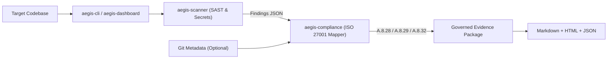

# AEGIS AI (Open-Core Engine)

> **Governed AI Security Operations Platform — Automated Code Scanner & ISO/IEC 27001:2022 Evidence Engine**

[](https://nodejs.org/)
[](./LICENSE)
[](#modules-overview)

AEGIS AI is an open-core reference implementation for a **governed AI security operations platform**. It pairs deterministic static security scanning with automated ISO/IEC 27001:2022 compliance evidence compilation and human-in-the-loop audit outputs (CLI, JSON payload, Markdown, interactive HTML, and local web portal).



## Architecture



## Modules Overview

- **`aegis-scanner`**: Scans source/config text files for leaked secret patterns (`SEC-001`..`SEC-005`: generic tokens, AWS Access Key IDs, PEM private keys, Slack webhooks, DB URIs) and SAST patterns (`VULN-001`..`VULN-005`: `eval()`, SQL string concatenation, `innerHTML` XSS, OS command injection, weak MD5/SHA-1 hashes).
- **`aegis-compliance`**: Evaluates scan metrics against **ISO/IEC 27001:2022** controls **A.8.28** (Secure Coding), **A.8.29** (Security Testing in Development), and **A.8.32** (Design, Development & System Acceptance), producing Markdown, HTML, and JSON evidence packages.
- **`aegis-cli` & `aegis-dashboard`**: Provides `scan`, `evidence`, and local `dashboard` commands plus an interactive browser UI.

## Quickstart

### Prerequisites
- Node.js `>= 18.0.0` and npm `>= 9.0.0`

### Install & Verify

```bash
git clone https://github.com/nickmountlion/aegis.git
cd aegis
npm ci
npm test
```

### Run Scans & Evidence Generation

```bash
# Scan the included synthetic fixture project
node aegis-cli/bin/aegis.js scan ./mock-project

# Emit raw JSON findings
node aegis-cli/bin/aegis.js scan ./mock-project --json

# Generate Markdown, HTML, and JSON ISO 27001 evidence under ./compliance-evidence/
node aegis-cli/bin/aegis.js evidence ./mock-project

# Launch local interactive dashboard at http://localhost:3000/
node aegis-cli/bin/aegis.js dashboard

# Run standalone smoke script
node test-run.js
```

## 3-Agent ISO 27001 Evidence Pipeline (Scope & Reproducibility)

In the broader **governed AI SecOps** architecture, evidence generation is designed as a 3-agent pipeline:
1. **Scanner Agent**: Runs deterministic SAST and secret checks (`aegis-scanner`).
2. **Compliance Mapping Agent**: Maps findings and repository metadata to ISO 27001 controls (`aegis-compliance`).
3. **Governance Review Agent**: Validates control narratives and flags findings requiring human sign-off.

**Reproducibility note:** This open-core repository implements the deterministic Stage 1 and Stage 2 engines in pure Node.js (scanning `mock-project` in ~8 ms locally). The LLM-backed multi-agent orchestration layer are **not** included in this repository. An end-to-end run of roughly 31 seconds was observed in the author's own testing of that full pipeline; it is a single observation, not a benchmark, and cannot be reproduced from this codebase alone. Note also that `aegis-cli` currently uses placeholder Git metadata rather than live `git log` inspection unless integrated externally, and outputs custom JSON (`evidence_payload.json`) rather than SARIF 2.1.0.

## Security & Confidentiality

- See [SECURITY.md](./SECURITY.md) for vulnerability reporting and local dashboard guidance.
- This repository contains **no proprietary client data, internal infrastructure references, or real credentials**. `mock-project/` contains intentional synthetic fixtures for scanner verification.

## License

Licensed under the [MIT License](./LICENSE).
